<h1 align="center">
  
</h1>

<p align="center">
  Free, open-source SEO audits for Shopify stores and any website, inside Claude Code,<br>
  Codex and Cursor. See what Google and AI crawlers can actually read, and what to fix first.
</p>

<p align="center">
  <a href="#install">Install</a> ·
  <a href="#for-shopify-stores">Shopify</a> ·
  <a href="#see-it-work">Demo</a> ·
  <a href="#what-it-catches">What it catches</a> ·
  <a href="#how-the-score-works">Scoring</a> ·
  <a href="#faq">FAQ</a>
</p>

Point your agent at your store or site and it reads it the way a crawler does. You get a score, the fixes that matter most, and the evidence behind every finding. On a Shopify store you also get Shopify checks, with fixes in Shopify admin and theme terms.

- **Free and open source.** MIT licensed, with no account, no API keys and no monthly app fee.
- **Nothing to set up.** Node runs the TypeScript directly, so there are no packages to install and no build step.
- **Evidence, not opinions.** Scripted checks produce the findings, so results are repeatable. Your agent explains them.
- **Works with your agent.** Built on the open [Agent Skills](https://agentskills.io) format, for Claude Code, Codex, Cursor and others that support it.

## For Shopify stores

Ask your agent:

```text
Audit my Shopify store https://yourstore.com
```

The audit detects Shopify and adds checks that generic SEO tools miss:

| Check | What it finds |
|---|---|
| Store is open | A password page that hides the whole store from Google and AI crawlers |
| Product data in the HTML | Product JSON-LD that an app adds with JavaScript, so crawlers that don't run JavaScript never see the price or stock |
| Product links | Themes that link products through `/collections/.../products/...`, creating a duplicate URL per collection |
| robots.txt defaults | A custom `robots.txt.liquid` that dropped Shopify's rules for sorted and filtered collections |
| Own domain | A store still served from `yourstore.myshopify.com` |

Every finding comes with the fix: the admin path or the theme file to change.

**Get recommended by ChatGPT, not just ranked on Google.** Shoppers ask AI assistants about their situation, such as "cooling sheets for hot sleepers under $150 that ship to Canada", not a two-word keyword. Ask for a prompt map:

```text
Build a prompt map for my Shopify store https://yourstore.com
```

Your agent turns your customers' own words from reviews and support emails into the questions they ask AI. It checks which ones your pages answer and gives one fix per gap. See [how it works](skills/shopify-seo/references/prompt-map.md).

**Shopify guides:** [SEO checklist](docs/shopify/seo-checklist.md) · [products not indexed](docs/shopify/products-not-indexed.md) · [duplicate product URLs](docs/shopify/duplicate-product-urls.md) · [robots.txt](docs/shopify/robots-txt.md) · [Product schema](docs/shopify/product-schema.md) · [ChatGPT visibility](docs/shopify/chatgpt-visibility.md)

## See it work

We built a demo store the way many Shopify stores are set up: a Dawn-style theme, a schema app, a redirect app and a custom robots.txt. It looks fine in a browser, and **it scores 87 out of 100 (B)**:



These are real results, showing the top five fixes. The worst one is invisible in a browser: the schema app adds the product's price and stock with JavaScript, so crawlers that read only the HTML never see them. The full report also explains why each finding matters and how to fix it. The store's code is in [examples/demo-shopify-store.ts](examples/demo-shopify-store.ts), so you can run the same audit yourself. See a [complete example report](docs/example-report.md), which a workflow keeps up to date.

## Install

**Claude Code**

```text
/plugin marketplace add JittoJoseph/seo-skills
/plugin install seo-skills@seo-skills
```

**Codex**

```bash
codex plugin marketplace add JittoJoseph/seo-skills
codex plugin add seo-skills@seo-skills
```

**Any agent that supports Agent Skills**

```bash
npx skills add JittoJoseph/seo-skills
```

**By hand**

```bash
git clone https://github.com/JittoJoseph/seo-skills.git
cp -r seo-skills/skills/* ~/.claude/skills/
```

## Run your first audit

Just ask your agent:

```text
Audit the SEO of https://yoursite.com
```

You can also use a command. In Claude Code it's `/seo-skills:seo audit <url>` when installed as a plugin, and `/seo audit <url>` when installed with `npx skills` or by hand.

It works on a local dev server too, and it doesn't need an agent:

```bash
node skills/seo-audit/scripts/audit.ts http://localhost:3000
```

## What it catches

Starter templates and AI builders leave behind problems that are easy to miss, because the site looks fine in a browser:

| Problem | Why it hurts |
|---|---|
| Content exists only in JavaScript | Many AI crawlers don't run JavaScript, so they see an empty page |
| The title or description is a template default | Text like "Vite + React" can become your headline in search results |
| Made-up URLs return 200 | Search engines can treat them as soft 404s and index junk URLs |
| Every canonical points at the homepage | This asks search engines to drop your other pages |
| A staging `noindex` or robots.txt block shipped | Your pages stay out of search results |
| The sitemap lists `localhost` | Crawlers get pointed at the wrong site |
| `/robots.txt` returns your app's HTML | Crawlers don't get real crawl rules or a sitemap location |

In total it runs 43 checks across seven areas:

| Area | What it looks at |
|---|---|
| Crawling and indexing | HTTPS, redirects, robots.txt, sitemaps, noindex, canonicals, real 404s, internal links |
| Rendering | Whether content is in the HTML, viewport, language |
| Titles and metadata | Missing, duplicate or default titles and descriptions, headings, alt text, hreflang |
| Structured data | Whether JSON-LD exists and is valid |
| Social sharing | Open Graph tags and whether the share image loads |
| AI search | Whether AI search crawlers are allowed in robots.txt |
| Shopify | Password page, Product data in the HTML, collection product links, robots.txt defaults, domain. Only on Shopify stores |

See every check, with its weight and how to fix it, in [checks.md](skills/seo-audit/references/checks.md).

## How the score works

- **You can recompute it.** Every check has a published weight. A pass earns the full weight, a warning earns half and a failure earns nothing.
- **Tidy tags can't hide a broken site.** Blocking search engines or setting `noindex` on the homepage caps the score at 40. An empty client-rendered homepage caps it at 60.
- **No false scores.** If a firewall blocks the audit, you get an explanation and no score.
- **No SEO myths.** `llms.txt` is reported but not scored, because [Google says](https://developers.google.com/search/docs/appearance/ai-features) you don't need new AI text files for its AI features.

The score measures technical foundations only. It doesn't measure rankings, traffic, backlinks, content quality or Core Web Vitals, and the audit doesn't run JavaScript.

## Use it in CI

Fail a build when the score drops below your limit:

```bash
node skills/seo-audit/scripts/audit.ts https://yoursite.com --fail-under 80
```

Use `--format json` for machine-readable output, `--pages <n>` to check more pages and `--help` for every option.

## Requirements

Node.js 22.18 or newer. Without Node, the skill falls back to a manual review with no score.

## Roadmap

- [x] `/seo audit`: audit any site from its URL
- [x] Plugin installs for Claude Code and Codex
- [x] `/seo shopify`: SEO checks and fixes for Shopify stores
- [x] `/seo prompts`: a prompt map of what shoppers ask AI assistants
- [ ] `/seo fix`: have your agent fix the findings in your theme or code
- [ ] More Shopify checks: collection content, variant URLs, Markets and hreflang
- [ ] Framework-specific fixes for Next.js, Astro, Nuxt and WordPress

## FAQ

**Is there a free, open-source Shopify SEO audit tool?**
Yes. SEO Skills is MIT licensed and runs inside Claude Code, Codex, Cursor and other agents that support Agent Skills. It needs no Shopify app, no account and no API key. It reads your store's public pages the way a crawler does.

**Does it need access to my Shopify admin?**
No. It audits the public storefront. Your agent then gives you the admin steps or the theme change for each fix. If your theme code is in your project, it can make the theme changes after you agree.

**Do I still need a Shopify SEO app?**
Maybe not. Shopify already makes your sitemap, canonical tags, robots.txt and `llms.txt`. Run the audit first, then pick an app only for a job it shows you need, such as bulk-editing meta descriptions. See the [checklist](docs/shopify/seo-checklist.md).

**How do I get my Shopify store into ChatGPT answers?**
Check that your store is eligible for Shopify Catalog, that AI search crawlers can read your pages, and that your product data is in the HTML. Then build a prompt map to find the questions shoppers ask that your pages don't answer. See [ChatGPT visibility](docs/shopify/chatgpt-visibility.md).

**Does it work on sites that aren't on Shopify?**
Yes. The Shopify checks only run on Shopify stores. Every other check works on any website, including a local dev server.

## Contributing

Found a wrong result or a missing check? [Open an issue](https://github.com/JittoJoseph/seo-skills/issues/new/choose) with the URL and what you expected. False positives are especially useful to report.

To work on the code, see [CONTRIBUTING.md](CONTRIBUTING.md). For security problems, see [SECURITY.md](SECURITY.md).

## License

[MIT](LICENSE) © [Jitto Joseph](https://github.com/JittoJoseph)

Shopify and the Shopify logo are trademarks of [Shopify Inc.](https://www.shopify.com) SEO Skills is an independent open-source project and is not affiliated with or endorsed by Shopify.
