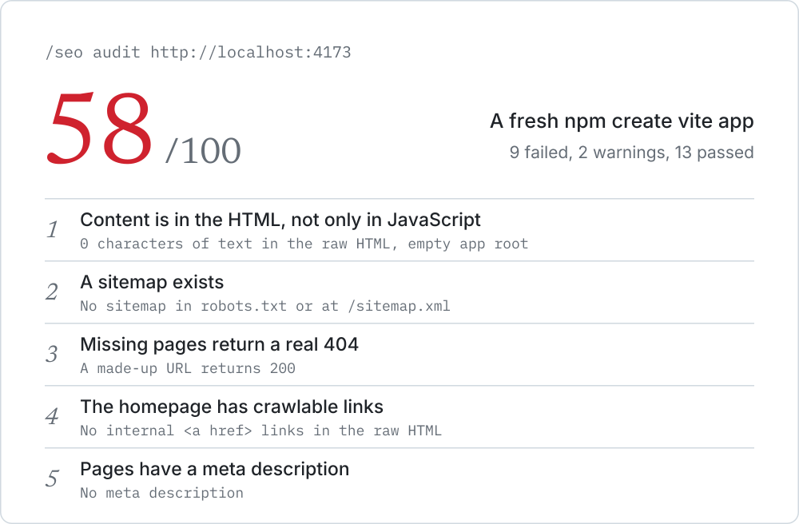

<h1 align="center">
  <picture>
    <source media="(prefers-color-scheme: dark)" srcset="assets/hero-dark.svg">
    
  </picture>
</h1>

<p align="center">
  Free SEO audits inside your AI coding agent. Find out what search engines<br>
  and AI crawlers can actually read, and what to fix first.
</p>

<p align="center">
  <a href="#install">Install</a> ·
  <a href="#see-it-work">Demo</a> ·
  <a href="#what-it-catches">What it catches</a> ·
  <a href="#how-the-score-works">Scoring</a> ·
  <a href="#roadmap">Roadmap</a>
</p>

Point your agent at any URL and it reads the site the way a crawler does. You get a score, the fixes that matter most, and the evidence behind every finding.

- **Free and open source.** MIT licensed, with no account and no API keys.
- **Nothing to set up.** Node runs the TypeScript directly, so there are no packages to install and no build step.
- **Evidence, not opinions.** Scripted checks produce the findings, so results are repeatable. Your agent explains them.
- **Works with your agent.** Built on the open [Agent Skills](https://agentskills.io) format, for Claude Code, Codex, Cursor and others that support it.

## See it work

We created a fresh app with `npm create vite`, built it, and audited it. It looks fine in a browser, and **it scores 58 out of 100**:

<picture>
  <source media="(prefers-color-scheme: dark)" srcset="assets/demo-dark.svg">
  
</picture>

These are real results, shortened to the top five fixes. The full report also explains why each finding matters and how to fix it. See a [complete example report](docs/example-report.md), which a workflow keeps up to date.

## Install

**Claude Code**

```text
/plugin marketplace add JittoJoseph/seo-skills
/plugin install seo-skills@seo-skills
```

**Codex**

```bash
codex plugin marketplace add JittoJoseph/seo-skills
codex plugin add seo-skills@seo-skills
```

**Any agent that supports Agent Skills**

```bash
npx skills add JittoJoseph/seo-skills
```

**By hand**

```bash
git clone https://github.com/JittoJoseph/seo-skills.git
cp -r seo-skills/skills/* ~/.claude/skills/
```

## Run your first audit

Just ask your agent:

```text
Audit the SEO of https://yoursite.com
```

You can also use a command. In Claude Code it's `/seo-skills:seo audit <url>` when installed as a plugin, and `/seo audit <url>` when installed with `npx skills` or by hand.

It works on a local dev server too, and it doesn't need an agent:

```bash
node skills/seo-audit/scripts/audit.ts http://localhost:3000
```

## What it catches

Starter templates and AI builders leave behind problems that are easy to miss, because the site looks fine in a browser:

| Problem | Why it hurts |
|---|---|
| Content exists only in JavaScript | Many AI crawlers don't run JavaScript, so they see an empty page |
| The title or description is a template default | Text like "Vite + React" can become your headline in search results |
| Made-up URLs return 200 | Search engines can treat them as soft 404s and index junk URLs |
| Every canonical points at the homepage | This asks search engines to drop your other pages |
| A staging `noindex` or robots.txt block shipped | Your pages stay out of search results |
| The sitemap lists `localhost` | Crawlers get pointed at the wrong site |
| `/robots.txt` returns your app's HTML | Crawlers don't get real crawl rules or a sitemap location |

In total it runs 38 checks across six areas:

| Area | What it looks at |
|---|---|
| Crawling and indexing | HTTPS, redirects, robots.txt, sitemaps, noindex, canonicals, real 404s, internal links |
| Rendering | Whether content is in the HTML, viewport, language |
| Titles and metadata | Missing, duplicate or default titles and descriptions, headings, alt text, hreflang |
| Structured data | Whether JSON-LD exists and is valid |
| Social sharing | Open Graph tags and whether the share image loads |
| AI search | Whether AI search crawlers are allowed in robots.txt |

See every check, with its weight and how to fix it, in [checks.md](skills/seo-audit/references/checks.md).

## How the score works

- **You can recompute it.** Every check has a published weight. A pass earns the full weight, a warning earns half and a failure earns nothing.
- **Tidy tags can't hide a broken site.** Blocking search engines or setting `noindex` on the homepage caps the score at 40. An empty client-rendered homepage caps it at 60.
- **No false scores.** If a firewall blocks the audit, you get an explanation and no score.
- **No SEO myths.** `llms.txt` is reported but not scored, because [Google says](https://developers.google.com/search/docs/appearance/ai-features) you don't need new AI text files for its AI features.

The score measures technical foundations only. It doesn't measure rankings, traffic, backlinks, content quality or Core Web Vitals, and the audit doesn't run JavaScript.

## Use it in CI

Fail a build when the score drops below your limit:

```bash
node skills/seo-audit/scripts/audit.ts https://yoursite.com --fail-under 80
```

Use `--format json` for machine-readable output, `--pages <n>` to check more pages and `--help` for every option.

## Requirements

Node.js 22.18 or newer. Without Node, the skill falls back to a manual review with no score.

## Roadmap

- [x] `/seo audit`: audit any site from its URL
- [x] Plugin installs for Claude Code and Codex
- [ ] `/seo fix`: have your agent fix the findings in your code
- [ ] Framework-specific fixes for Next.js, Astro, Nuxt and WordPress
- [ ] `/seo shopify`: SEO checks and fixes for Shopify stores

## Contributing

Found a wrong result or a missing check? [Open an issue](https://github.com/JittoJoseph/seo-skills/issues/new/choose) with the URL and what you expected. False positives are especially useful to report.

To work on the code, see [CONTRIBUTING.md](CONTRIBUTING.md). For security problems, see [SECURITY.md](SECURITY.md).

## License

[MIT](LICENSE) © [Jitto Joseph](https://github.com/JittoJoseph)
